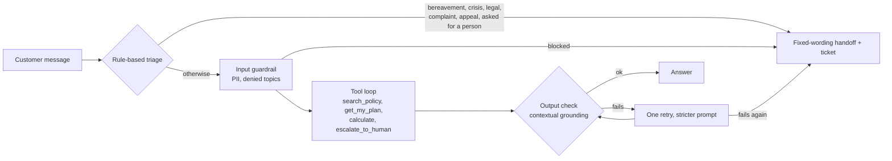

# Bedrock support-bot: a measured prototype

A contact-centre assistant for a **fictional** insurer ("Evergreen Life") on Amazon Bedrock: retrieval over policy documents, tools, guardrails, a grounding check and human handoff. It is a learning project built to measure design choices, not a product. **All policies, customers and tickets are invented. Do not put real personal data into it.**

Every claim in this README is backed by a results file in `eval/` and dated notes in `docs/notes.md`, including the dead ends. Question sets are small (8 to 30 questions), runs are single passes, and one model (Claude Haiku 4.5) was used throughout, so read the numbers as observations, not benchmarks.

## How a message is handled



- **Identity comes from the session.** `get_my_plan` takes no arguments, so the model cannot ask for another customer's data.
- **Crisis wording is fixed text** and never generated by the model.
- **The first model call must be `search_policy`**, so a first answer is grounded or escalated.
- **A reply that promises a handoff creates a ticket**, and the handoff log never stores the customer's message.

## What I measured

| Question | Finding | Detail |
| --- | --- | --- |
| Which chunking? | 200-character windows beat one-line and whole-document chunks once I added rephrased questions; hybrid keyword search did not help | `docs/notes.md`, `eval/results_hybrid.json` |
| Hand-built vs managed retrieval? | A Bedrock Knowledge Base with hierarchical chunking matched the best hand-built setup on ranking (MRR 0.97 vs 0.97) | `eval/results_kb_*.json` |
| Hand-written loop vs Strands SDK vs managed runtime? | Same behaviour on the same sets: escalation 12/12, agent set 7 PASS, 0 FAIL, 1 REVIEW | `eval/results_agent_*.json` |
| Does a grounding score catch wrong answers? | No. Two wrong answers passed at 0.94 and 0.98. A claim-level verifier caught both and 31 of 31 injected errors, and flagged 1 of 26 clean answers | `eval/results_verifier*.json` |

Not built or not run: the verifier is not wired into the agent, there is no re-ranker, no load or concurrency test, and no UI.

## Layout

```
data/policies/    11 invented policy documents        data/customers.json  3 invented customers
src/agent.py      orchestration: triage, guardrail, tool loop, output check, retry, handoff
src/tools.py      tools and the per-customer session   src/triage.py  rule-based routing
src/pipeline.py   retrieval (OpenSearch or Knowledge Base) and guardrail helpers
src/agent_strands.py   the same agent on the Strands SDK
src/agentcore_*.py     the same agent hosted on AgentCore Runtime
src/verify.py, mutate.py   claim-level verifier and error injection
src/stepN_*.py    numbered scripts: create resources, run an experiment, tear down
eval/             question sets and saved results      docs/notes.md  dated lab notes
tests/            offline tests with stubbed AWS calls
```

## Running it

Needs Python 3.12, [uv](https://docs.astral.sh/uv/), AWS credentials with Bedrock access, and region `us-east-1`. **Model access differs by account**: probe first with `step0b_probe_models.py` and use an inference-profile ID such as `us.anthropic.claude-haiku-4-5-20251001-v1:0`.

```bash
uv venv && uv pip install -r requirements.txt
export MODEL_ID=us.anthropic.claude-haiku-4-5-20251001-v1:0   # and EMBED_MODEL_ID if you override Titan v2

uv run python src/step2a_create_guardrail.py                   # guardrail (writes .guardrail.json)
uv run python src/step6a_kb_create.py hierarchical             # S3, S3 Vectors, IAM, Knowledge Base (writes .kb.json)

RETRIEVER=kb VARIANT=hierarchical uv run python src/step5_eval_agent.py escalation
RETRIEVER=kb VARIANT=hierarchical uv run python src/agent.py C1001 "How much dental do I have left this year?"
```

`AGENT_DRIVER=strands` runs the Strands version. `src/step9a_agentcore_deploy.py` deploys it to AgentCore Runtime and `AGENT_REMOTE=agentcore` runs the evals against it. `step3b` and `step3d` set up the optional OpenSearch Serverless retriever (the default if `RETRIEVER` is unset).

Tests run offline:

```bash
uvx --with boto3 --with opensearch-py --with numpy --with pytest --with strands-agents pytest tests -q
uvx ruff check src tests && uvx ruff format src tests
```

## Cost and teardown

Everything is created by script and removed by script. **Remove what you create**, in this order:

```bash
uv run python src/step9z_agentcore_teardown.py   # runtime, logs, bucket, role
uv run python src/step6z_kb_teardown.py          # knowledge base, vector index, buckets, role
uv run python src/step3z_teardown.py             # OpenSearch collection, if you made one
```

Model calls are the main cost of the experiments. OpenSearch Serverless bills continuously while a collection holds capacity or data; set a budget alert. I have not yet checked the idle cost of these resources against a bill.

## Limitations

Tiny synthetic data; question sets partly used while tuning (the fresh set was run once); an instrument I wrote checks most answers (key facts, plus a model-based verifier from the same family); no adversarial or load testing; no authentication beyond IAM.

## Licence

MIT. See `LICENSE`.
